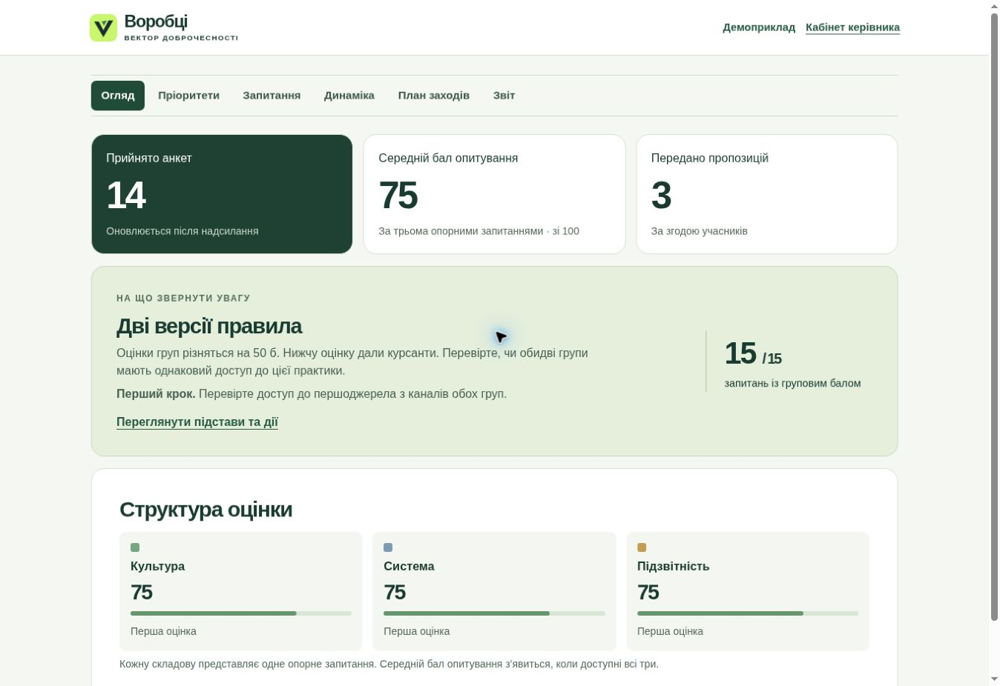

# Воробці — Вектор доброчесності

ХАКАТОН_ЗАВДАННЯ

[Відкрити сайт](https://arturnohotkov.github.io/-/) · [Пройти анкету](https://arturnohotkov.github.io/-/survey/) · [Конкурсна презентація з озвученням](https://arturnohotkov.github.io/-/presentation.html) · [MP4-демо](https://arturnohotkov.github.io/-/demo.mp4)

Завдання 3 · Integrity Management Dashboard · IV Building Integrity Hackathon, 2026



## Для кого цей прототип

Керівництву ВВНЗ та антикорупційному уповноваженому потрібно розуміти, чи бачить персонал на практиці ті механізми, які установа описує у звітах. «Вектор» зводить опитування, оцінку робочої групи й документи в один цикл. Курсант або викладач проходить одноразову анонімну анкету та отримує узагальнені підсумки. Для журі підготовлено умовний військовий інститут та виключно синтетичні дані.

## Спільна анкета та кабінет керівника

[Воробці](https://arturnohotkov.github.io/-/). На головній оберіть «Пройти анкету». Учасники з різних браузерів надсилають відповіді в один спільний збір. Керівник вводить приватний ключ у своєму кабінеті й бачить нові надходження протягом п’яти секунд. За бажанням учасник може передати окрему запропоновану дію без імені або індивідуальних балів. Оцінки кожного запитання публікуються порціями по сім змістовних відповідей однієї категорії. Середній бал трьох опорних питань стосується опитування. Повний інституційний індекс потребує також інших джерел. Історичні синтетичні дані та вправи з ролями доступні за кнопкою «Демоприклад».

У живій анкеті є 12 основних запитань і три додаткові ситуації. Учасник обирає, яку саме пропозицію передати. Лічильники за попередньою категорією «Працівники» відокремлено від нових оцінок викладачів.

У кабінеті є шість розділів: огляд, пріоритети, запитання, динаміка, план заходів і звіт. Для кожної практики видно доступні групові бали, кількість врахованих у них відповідей і рекомендацію. Керівник може призначити відповідального, вказати строк, змінити статус заходу, надрукувати звіт або завантажити CSV.

## Спільний сервер з цього самого репозиторію

Код незалежного спільного API, D1-схеми та GitHub Actions для розгортання Cloudflare Workers додано до **цього самого репозиторію**, без ChatGPT Sites. Див. [інструкцію з підключення сервера](docs/backend-in-same-repository.md). Після налаштування хостингу та безпечного перенесення наявної бази керівник зможе синхронізувати заходи між пристроями. **Поки чинний сервер не оновлено або не переключено на налаштований, реальна синхронізація ще не активна; локальні записи не видаляйте.**

## Демонстрація

[Демонстраційна панель](https://arturnohotkov.github.io/-/demo/) · [Прямий вхід до демонстраційної анкети](https://arturnohotkov.github.io/-/demo/#survey). У демоприкладі кожен браузер отримує окремий простір. Для спільного збору в одному циклі уповноважений видає кожному учаснику окреме одноразове запрошення.

[Дивитися відео у браузері](https://arturnohotkov.github.io/-/demo.mp4) · [MP4 у репозиторії](docs/demo.mp4) · [Субтитри SRT](docs/demo.uk.srt) · [Текст для озвучення](docs/demo-narration.txt). Відео містить лише навчальні дані.

1. На головній панелі відкрийте **Переглянути підстави**. У листопадовому циклі 2026 року індекс дорівнює 76,2. Для каналів повідомлення бал опитування становить 45,5, документальна перевірка дає 90. Відкрийте формулу в розділі **Методика**.
2. Натисніть **Тестова анкета**. Пройдіть 12 запитань, по чотири за кожним напрямом. У розділі **Профіль практик** оберіть висновок або напрям, відкрийте рядок і перевірте підставу. Для практики, що потребує розвитку або має розрив між групами, можна прийняти окремий захід.
3. Відкрийте рекомендацію щодо каналів, уточніть захід, призначте підрозділ і строк. Стан заходу доступний у плані.
4. З ролі **Уповноважений** можна видати одноразове запрошення або внести показники у розділі **Оцінювання**. Змінені показники потребують підтвердження керівником.
5. Як керівник завершіть грудневий цикл. У плані поруч із прийнятим заходом з’явиться наступна оцінка і зміна відносно базової. Розділ **Звіти** дає CSV або друк у PDF.

## Відкрити одним файлом або через GitHub Pages

Збережіть [vektor.html](public/vektor.html) та відкрийте його в сучасному браузері. Анкета, порівняння циклів, план і експорт CSV працюють на пристрої без сервера, реєстрації та інтернету. Демодані належать одній вкладці. Для опитування людей із різних пристроїв використовуйте серверну версію та одноразові запрошення.

Для публічної адреси на GitHub Pages у командному репозиторії оберіть **Settings → Pages → Source → GitHub Actions**. Після оновлення гілки `main` або ручного запуску процесу **Публічна демонстрація на GitHub Pages** GitHub перевіряє код і публікує сайт. На сторінках GitHub учасники проходять спільну анкету, а керівник може увійти з тим самим ключем. Запити йдуть до спільної бази сервера через HTTPS. Офлайн-демо доступне окремо. Адресу показано в розділі **Deployments → github-pages**. HTML можна відтворити з вихідного коду командою `node offline/build-html.mjs`.

## Як запустити спільний сервер автономно

Потрібен Node.js 22.13+ із вбудованим модулем node:sqlite. Після завантаження архіву розпакуйте його й відкрийте термінал у каталозі з цим README. Після клонування репозиторію перейдіть у його корінь.

```sh
node offline/server.mjs
```

Відкрийте http://127.0.0.1:4173 у браузері. Встановлення npm-пакетів, ключі зовнішніх сервісів та інтернет для роботи цього варіанта не потрібні. SQLite зберігає стан між запусками у .local-data/. Вкладки одного профілю браузера використовують спільний демопростір. Незалежним відвідувачам видаються окремі простори.

```sh
node --test checks/*.test.mjs
```

## Як влаштовано

- **public/** містить український адаптивний інтерфейс, стилі й знак проєкту.
- **core/model.mjs** містить критерії, адаптовані анкети, синтетичні агрегати, формулу, правила рекомендацій і порівняння циклів.
- **core/api.mjs** перевіряє ролі, опрацьовує одноразові запрошення, підтвердження джерел та управлінські дії.
- **offline/server.mjs** запускає HTTP API й той самий інтерфейс локально. Хостингова версія використовує те саме ядро з адаптером D1.
- **checks/** містить відтворювані перевірки методики, анонімності, доступу і наскрізного сценарію.

## Матеріали для оцінювання

| Файл | Зміст |
|---|---|
| [Методика, джерела й обмеження](docs/method.md) | Карта питань і пунктів чек-листа, формула, приклад розрахунку та інтерпретація сигналів |
| [Архітектура й інтеграція](docs/integration.md) | Автономний режим, API, карта потенційних систем та межі підключення |
| [Анонімність і зловживання](docs/privacy.md) | Розмежування доступу, поріг, захист від повторного голосування й межі прототипу |
| [Розрахунок економії часу](docs/time.md) | Сценарні припущення та окремий технічний замір |
| [Використання ШІ](docs/ai.md) | Внесок інструмента та зафіксований вибір учасника |
| [Приклад звіту](docs/example.csv) | Експорт листопадового циклу з тих самих даних, що й панель |

## Походження матеріалів

Основа для анкет і чек-листа — відкриті Рекомендації Міноборони та НУОУ, Київ, 2025. Тексти питань і шкали адаптовано. Бал 0–100, ваги і пороги є демонстраційною моделлю. Інтерфейс використовує HTML, JavaScript, CSS та системні шрифти. В автономній збірці використовуються стандартні модулі Node.js і SQLite. Для розробки й перевірки використано ChatGPT / Codex. У хостинговій оболонці використовуються Vinext, Vite, Drizzle і Cloudflare Workers. Код проєкту поширюється за [MIT](LICENSE).


Для спільного збору на власному сервері передайте в середовище Node.js змінну `VECTOR_MANAGER_HASH` із SHA-256 випадкового приватного ключа керівника у вигляді 64 шістнадцяткових символів. Сервер зберігає дані у SQLite. Повторні надсилання того самого браузерного квитка враховуються один раз. Очищення даних браузера, інший пристрій або інший домен дають окремий квиток. Для контрольованої вибірки передбачено режим установи з одноразовими запрошеннями.

## Конкурсна мультимедійна презентація

[Відкрити презентацію «Воробці»](https://arturnohotkov.github.io/-/presentation.html). Повноекранна анімована презентація складається з дев'яти сцен (приблизно 2 хв 46 с) з інтерактивним керуванням, українським текстом диктора, навігацією, прогресом і озвученням через Speech Synthesis браузера. Для голосу потрібен встановлений український системний голос; на деяких пристроях голос може бути недоступним. Це вебпрезентація, а не MP4 із вбудованою звуковою доріжкою. Попередній MP4 залишається доступним.
